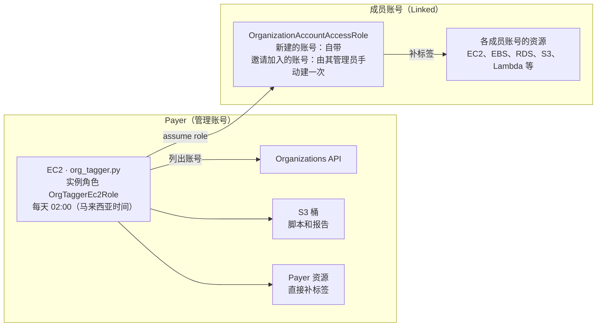

# 部署与运维指南

本文档说明如何把 `org_tagger.py` 部署到 Payer（管理账号）的 EC2 上每天定时运行，以及上线前后要在 Payer 和各成员账号里做的事。脚本的工作原理、参数和报告字段见 [README.md](README.md)。

## 部署架构

标签要写在每个成员账号自己的资源上，Payer 只负责调度。这里不用 StackSets：所有成员账号统一使用同名角色 `OrganizationAccountAccessRole`，Payer 里的一台 EC2 定时运行 `org_tagger.py`，逐个 assume 这个角色去补标签，报告存到 S3。



EC2 先从 Organizations 列出账号，再逐个 assume 成员账号里的 `OrganizationAccountAccessRole` 去补标签；Payer 自己的资源直接用实例角色处理，报告写进 S3。

| 在哪里做 | 做什么 | 频率 |
| --- | --- | --- |
| Payer（管理账号） | 检查哪些账号缺角色；创建 S3 桶、EC2 实例角色和 EC2 | 一次 |
| Linked（成员账号） | Organizations 新建的账号已自带角色，无需操作；邀请加入的账号由其管理员手动建一次角色 | 一次；以后新邀请的账号各建一次 |
| EC2（在 Payer 里） | 定时运行脚本，报告上传 S3 | 每天 |

## 实施顺序

1. [确认前置条件](#1-前置条件)
2. [Payer 账号检查](#2-payer-账号检查)
3. [成员账号创建角色](#3-成员账号创建角色)
4. [在 Payer 部署 EC2](#4-在-payer-部署-ec2)
5. [首次上线](#5-首次上线)：试跑、全量 dry-run、审报告、apply、复查
6. 转为每天定时运行，进入[日常运维](#6-日常运维与常见问题)

## 1. 前置条件

开工前把下面几项逐一确认，其中标签范围和邀请账号的角色最关键：前者决定哪些账号该打，后者决定 Payer 能不能进入这些账号。

- [ ] 确定标签 key 和 value。MAP 项目的 key 固定为全小写 `map-migrated`，value 用 MAP 协议对应的 MPE 值（例如 `migXXXXXXXXXX`）。
- [ ] 跟 BD / AWS 确认范围：哪些账号、哪些资源在 MAP 范围内。不在范围内的账号记下 ID，之后放进配置里的 `EXCLUDE_ACCOUNTS`。
- [ ] Payer 上有一个管理员身份，用来创建 S3 桶、IAM 角色和 EC2。
- [ ] Payer 已开启 Cost Explorer（MAP 必需）。
- [ ] 邀请加入的账号能联系到其管理员，由对方建一次角色。客户账号要先获得授权，并告知对方这个角色是管理员权限、信任的是 Payer。
- [ ] 从本仓库取得 `org_tagger.py`。

在 Payer 的 CloudShell 里盘点账号。`JoinedMethod` 为 `INVITED` 的账号通常没有 `OrganizationAccountAccessRole`，第 2 步会逐个检查。

```bash
aws organizations list-accounts \
  --query "Accounts[].[Id,Name,JoinedMethod]" --output table
```

## 2. Payer 账号检查

Payer 上要先做两件事：检查每个成员账号能否用 `OrganizationAccountAccessRole` 进入，以及确认成本分配标签。S3 桶、实例角色和 EC2 在[第 4 步](#4-在-payer-部署-ec2)创建。下面的命令都在 Payer 的 CloudShell 里执行。

### 检查哪些账号缺角色

输出为 `MISSING` 的账号，要按[第 3 步](#3-成员账号创建角色)在该账号里创建角色。已暂停的账号也会显示 `MISSING`，可以忽略；管理账号自己不需要这个角色，循环里已跳过。

```bash
PAYER_ID=$(aws sts get-caller-identity --query Account --output text)
for id in $(aws organizations list-accounts --query "Accounts[].Id" --output text); do
  [ "$id" = "$PAYER_ID" ] && continue
  if aws sts assume-role \
       --role-arn "arn:aws:iam::${id}:role/OrganizationAccountAccessRole" \
       --role-session-name check > /dev/null 2>&1; then
    echo "$id OK"
  else
    echo "$id MISSING"
  fi
done
```

### 成本分配标签

MAP 的 `map-migrated` 会自动激活为成本分配标签，不用手动操作。如果用的是自定义 key，要在 Billing → Cost allocation tags 里手动激活。新 key 在打上标签后才会出现在列表里，出现和生效都可能要等最多 24 小时。

### 权限提醒

`OrganizationAccountAccessRole` 是管理员权限。后面 EC2 的实例角色能 assume 进所有成员账号，相当于持有全组织的管理员权限。所以这台 EC2 不开任何入站端口，只用 Session Manager 登录，并限制谁有权连接它。

## 3. 成员账号创建角色

Organizations 新建的成员账号已自带 `OrganizationAccountAccessRole`，无需任何操作。第 2 步检查结果为 `MISSING` 的账号（通常是邀请加入的），需要由该账号的管理员登录后创建一次角色；Payer 进不去这些账号，没法替它们创建。

| 情况 | 要做什么 |
| --- | --- |
| Organizations 新建的账号 | 无需操作，角色已自带 |
| 邀请加入的账号（检查结果为 `MISSING`） | 账号管理员按下面任一方式创建角色，角色名必须是 `OrganizationAccountAccessRole` |
| 管理账号（Payer）本身 | 不需要角色，脚本直接用 EC2 实例角色处理 |

### 方式一：控制台

1. 用该成员账号的管理员身份登录，进入 IAM → Roles → Create role。
2. Trusted entity type 选 AWS account，再选 Another AWS account，填入 Payer 账号 ID。
3. 权限策略勾选 `AdministratorAccess`。
4. Role name 填 `OrganizationAccountAccessRole`，点 Create role。

### 方式二：命令行

在该成员账号的 CloudShell 里执行：

```bash
PAYER_ID=123456789012   # 改成 Payer 账号 ID

cat > trust.json << EOF
{
  "Version": "2012-10-17",
  "Statement": [{
    "Effect": "Allow",
    "Principal": {"AWS": "arn:aws:iam::${PAYER_ID}:root"},
    "Action": "sts:AssumeRole"
  }]
}
EOF

aws iam create-role --role-name OrganizationAccountAccessRole \
  --assume-role-policy-document file://trust.json
aws iam attach-role-policy --role-name OrganizationAccountAccessRole \
  --policy-arn arn:aws:iam::aws:policy/AdministratorAccess
```

建好后回到 Payer，再跑一次[第 2 步的检查循环](#检查哪些账号缺角色)，确认该账号变成 `OK`。

### 和各账号负责人确认

- **SCP**：作用于该账号的 SCP 不能拒绝打标签相关的操作，也不能拒绝资源所在的 region。SCP 对管理账号不生效。
- **IaC 管理的资源**：Terraform 或 CloudFormation 管理的资源，要同步把标签写进代码（Terraform 可用 provider 的 `default_tags`），否则下次部署可能把脚本打的标签抹掉。
- **以后新建的实例**：在启动模板里加上标签，或在 Auto Scaling 组的标签上设 `PropagateAtLaunch=true`。脚本每天会补，但从源头加上更可靠。

## 4. 在 Payer 部署 EC2

EC2 放在 Payer 账号里，用实例角色运行脚本，不开任何入站端口，只通过 Session Manager 登录。systemd 定时器每天运行一次，报告上传到 S3。放在 Payer 是因为脚本要调用 `organizations:ListAccounts`，只有管理账号能直接调用。

4.1 到 4.3 在 Payer 的同一个 CloudShell 会话里执行，后面的步骤会用到 4.1 设置的变量；4.4 起在 EC2 实例里执行。

### 4.1 创建 S3 桶并上传脚本

先把 `org_tagger.py` 上传到 CloudShell（右上角 Actions → Upload file）。新建的桶默认阻止公开访问，不需要额外设置。

```bash
PAYER_ID=$(aws sts get-caller-identity --query Account --output text)
REGION=ap-southeast-1            # EC2 和桶所在的 region，选离你近的
BUCKET=org-tagger-$PAYER_ID

aws s3 mb s3://$BUCKET --region $REGION
aws s3 cp org_tagger.py s3://$BUCKET/bin/org_tagger.py
```

### 4.2 创建 EC2 实例角色

策略的前三段是必需的：列出账号、assume 进成员账号、读写 S3 桶。后两段用来给 Payer 自己的资源打标签；如果 Payer 里没有业务资源，可以删掉这两段，并把 Payer 账号 ID 加进配置里的 `EXCLUDE_ACCOUNTS`。把下面的内容保存为 `org-tagger-policy.json`：

```json
{
  "Version": "2012-10-17",
  "Statement": [
    {
      "Sid": "Organizations",
      "Effect": "Allow",
      "Action": ["organizations:ListAccounts", "organizations:DescribeOrganization"],
      "Resource": "*"
    },
    {
      "Sid": "AssumeMemberRole",
      "Effect": "Allow",
      "Action": "sts:AssumeRole",
      "Resource": "arn:aws:iam::*:role/OrganizationAccountAccessRole"
    },
    {
      "Sid": "ScriptBucket",
      "Effect": "Allow",
      "Action": ["s3:GetObject", "s3:PutObject"],
      "Resource": "arn:aws:s3:::BUCKET_NAME/*"
    },
    {
      "Sid": "PayerOwnResourcesRead",
      "Effect": "Allow",
      "Action": [
        "tag:GetResources",
        "ec2:DescribeRegions", "ec2:DescribeInstances", "ec2:DescribeVolumes",
        "ec2:DescribeSnapshots", "ec2:DescribeImages", "ec2:DescribeAddresses",
        "ec2:DescribeNatGateways", "ec2:DescribeVpcEndpoints",
        "rds:DescribeDBInstances", "rds:DescribeDBClusters",
        "rds:DescribeDBSnapshots", "rds:DescribeDBClusterSnapshots",
        "lambda:ListFunctions", "lambda:ListTags",
        "elasticloadbalancing:DescribeLoadBalancers", "elasticloadbalancing:DescribeTags",
        "dynamodb:ListTables", "dynamodb:DescribeTable", "dynamodb:ListTagsOfResource",
        "elasticfilesystem:DescribeFileSystems",
        "elasticache:DescribeCacheClusters", "elasticache:ListTagsForResource",
        "eks:ListClusters", "eks:DescribeCluster",
        "s3:ListAllMyBuckets", "s3:GetBucketLocation", "s3:GetBucketTagging",
        "cloudfront:ListDistributions", "cloudfront:ListTagsForResource"
      ],
      "Resource": "*"
    },
    {
      "Sid": "PayerOwnResourcesTag",
      "Effect": "Allow",
      "Action": [
        "tag:TagResources", "ec2:CreateTags", "rds:AddTagsToResource",
        "lambda:TagResource", "elasticloadbalancing:AddTags", "dynamodb:TagResource",
        "elasticfilesystem:TagResource", "elasticache:AddTagsToResource",
        "eks:TagResource", "s3:PutBucketTagging", "cloudfront:TagResource"
      ],
      "Resource": "*"
    }
  ]
}
```

然后创建角色和实例配置文件：

```bash
sed -i "s/BUCKET_NAME/$BUCKET/" org-tagger-policy.json

cat > trust-ec2.json << 'EOF'
{"Version":"2012-10-17","Statement":[{"Effect":"Allow","Principal":{"Service":"ec2.amazonaws.com"},"Action":"sts:AssumeRole"}]}
EOF

aws iam create-role --role-name OrgTaggerEc2Role \
  --assume-role-policy-document file://trust-ec2.json
aws iam attach-role-policy --role-name OrgTaggerEc2Role \
  --policy-arn arn:aws:iam::aws:policy/AmazonSSMManagedInstanceCore
aws iam put-role-policy --role-name OrgTaggerEc2Role \
  --policy-name OrgTagger --policy-document file://org-tagger-policy.json
aws iam create-instance-profile --instance-profile-name OrgTaggerEc2Role
aws iam add-role-to-instance-profile \
  --instance-profile-name OrgTaggerEc2Role --role-name OrgTaggerEc2Role
```

成员账号里的 `OrganizationAccountAccessRole` 信任的是整个 Payer 账号，所以这台 EC2 的角色有了 `sts:AssumeRole` 权限就能进入，成员账号那边不用再改。

### 4.3 启动 EC2

子网要能访问 AWS API：公有子网并自动分配公网 IP，或私有子网走 NAT。安全组不加任何入站规则，也不需要密钥对。

```bash
AMI=$(aws ssm get-parameter --region $REGION \
  --name /aws/service/ami-amazon-linux-latest/al2023-ami-kernel-default-x86_64 \
  --query Parameter.Value --output text)

aws ec2 run-instances --region $REGION \
  --image-id $AMI --instance-type t3.small \
  --subnet-id <子网ID> --security-group-ids <安全组ID> \
  --iam-instance-profile Name=OrgTaggerEc2Role \
  --metadata-options HttpTokens=required \
  --tag-specifications 'ResourceType=instance,Tags=[{Key=Name,Value=org-tagger}]'
```

如果提示实例配置文件无效，是刚创建的 IAM 还没生效，等十几秒再执行一次。

### 4.4 登录并安装

在 EC2 控制台选中实例，点 Connect → Session Manager。以下命令在实例里执行：

```bash
BUCKET=org-tagger-<Payer账号ID>

sudo dnf install -y python3.11 python3.11-pip
sudo mkdir -p /opt/org-tagger/reports
sudo python3.11 -m venv /opt/org-tagger/venv
sudo /opt/org-tagger/venv/bin/pip install --upgrade boto3
sudo aws s3 cp s3://$BUCKET/bin/org_tagger.py /opt/org-tagger/
```

### 4.5 写配置文件和运行脚本

配置文件 `/opt/org-tagger/.env` 集中放标签和运行模式（文件名以点开头，`ls` 默认不显示，要用 `ls -a`）。先保持 `MODE=dryrun`，审完报告再改成 `apply`。

```bash
sudo tee /opt/org-tagger/.env > /dev/null << 'EOF'
# 要打的标签
TAG_KEY=map-migrated
TAG_VALUE=migXXXXXXXXXX
ROLE_NAME=OrganizationAccountAccessRole
# 不在范围内的账号，空格分隔；没有就留空
EXCLUDE_ACCOUNTS=""
# 额外参数，例如只跑部分 region：--regions ap-southeast-1 ap-southeast-5
EXTRA_ARGS=""
# dryrun 只出报告；确认报告后改成 apply
MODE=dryrun
REPORT_BUCKET=org-tagger-<Payer账号ID>
AWS_DEFAULT_REGION=ap-southeast-1
EOF
```

运行脚本读取配置、执行 `org_tagger.py`、把报告传到 S3，并清理 30 天前的本地报告：

```bash
sudo tee /opt/org-tagger/run.sh > /dev/null << 'EOF'
#!/bin/bash
set -euo pipefail
set -a; source /opt/org-tagger/.env; set +a
cd /opt/org-tagger

OUT="/opt/org-tagger/reports/report-$(date +%Y%m%d-%H%M%S).csv"
ARGS=(--tag-key "$TAG_KEY" --tag-value "$TAG_VALUE" --role-name "$ROLE_NAME" --output "$OUT")
if [ -n "${EXCLUDE_ACCOUNTS:-}" ]; then ARGS+=(--exclude-accounts $EXCLUDE_ACCOUNTS); fi
if [ -n "${EXTRA_ARGS:-}" ]; then ARGS+=($EXTRA_ARGS); fi
if [ "${MODE:-dryrun}" = "apply" ]; then ARGS+=(--apply); fi

/opt/org-tagger/venv/bin/python org_tagger.py "${ARGS[@]}"
aws s3 cp "$OUT" "s3://$REPORT_BUCKET/reports/$(basename "$OUT")"
find /opt/org-tagger/reports -name '*.csv' -mtime +30 -delete
EOF
sudo chmod +x /opt/org-tagger/run.sh
```

### 4.6 设置每天定时运行

下面的定时器在每天马来西亚时间凌晨 2 点（UTC 18:00）运行一次；实例关机错过的那次，开机后会补跑。要换时间或时区，改 `OnCalendar` 这一行。

```bash
sudo tee /etc/systemd/system/org-tagger.service > /dev/null << 'EOF'
[Unit]
Description=Org-wide resource tagging
Wants=network-online.target
After=network-online.target

[Service]
Type=oneshot
ExecStart=/opt/org-tagger/run.sh
EOF

sudo tee /etc/systemd/system/org-tagger.timer > /dev/null << 'EOF'
[Unit]
Description=Run org-tagger daily

[Timer]
OnCalendar=*-*-* 02:00:00 Asia/Kuala_Lumpur
Persistent=true

[Install]
WantedBy=timers.target
EOF

sudo systemctl daemon-reload
sudo systemctl enable --now org-tagger.timer
systemctl list-timers org-tagger.timer
```

### 常用命令

在 EC2 实例里执行：

```bash
sudo systemctl start org-tagger.service          # 立即手动跑一次（跑完才返回）
journalctl -u org-tagger.service -n 100          # 看最近的日志
sudo aws s3 cp s3://org-tagger-<Payer账号ID>/bin/org_tagger.py /opt/org-tagger/   # 更新脚本
```

## 5. 首次上线

首次上线分五步：单账号试跑、全组织 dry-run、审报告、正式执行、复查。之后保持 `MODE=apply`，定时任务每天自动给新资源补标签。

1. **单账号试跑**：在 EC2 的 Session Manager 里，挑一个测试账号和一个 region 跑 dry-run，确认报告内容符合预期。

   ```bash
   cd /opt/org-tagger
   sudo AWS_DEFAULT_REGION=ap-southeast-1 venv/bin/python org_tagger.py \
     --role-name OrganizationAccountAccessRole \
     --tag-key map-migrated --tag-value migXXXXXXXXXX \
     --accounts <测试账号ID> --regions ap-southeast-1 \
     --output reports/test.csv
   ```

2. **全组织 dry-run**：确认配置里是 `MODE=dryrun`，然后执行 `sudo systemctl start org-tagger.service`。报告会上传到 `s3://<桶名>/reports/`，可以在 S3 控制台直接下载。
3. **审报告**：用 Excel 打开 CSV，按 `action` 列筛选，重点看三类。`WOULD_TAG` 里如果有不在范围内的账号，加进 `EXCLUDE_ACCOUNTS`；`CONFLICT` 要确认已有的值该不该覆盖；`ERROR` 通常是账号缺角色。各类 action 的处理方法见下面的[审报告](#审报告)。
4. **正式执行**：把模式改成 apply 后再手动跑一次。

   ```bash
   sudo sed -i 's/^MODE=.*/MODE=apply/' /opt/org-tagger/.env
   sudo systemctl start org-tagger.service
   ```

5. **复查**：第二天定时任务跑完后看新报告。理想情况下只剩 `OK` 和你决定保留的 `CONFLICT`；出现 `FAILED` 或 `ERROR`，按[第 6 步](#6-日常运维与常见问题)处理。

### 审报告

报告里 `action` 列的含义：

| action | 含义 | 怎么处理 |
| --- | --- | --- |
| `OK` | 已经是正确的值 | 不用处理 |
| `WOULD_TAG` | dry-run 时表示会被打上 | 审一遍是否在范围内 |
| `TAGGED` | 本次已打上 | 不用处理 |
| `CONFLICT` | 已有同名 key 但值不同，脚本没有改动 | 确认要覆盖时临时加 `--overwrite` |
| `FAILED` | 单个资源打标签失败 | 看 `detail` 列，按[常见问题](#6-日常运维与常见问题)处理 |
| `ERROR` | 整个服务或账号出错，例如 assume role 失败 | 看 `detail` 列，按[常见问题](#6-日常运维与常见问题)处理 |

## 6. 日常运维与常见问题

上线后日常只需看每天的报告；下表是最常遇到的情况和处理方法。

| 情况 | 处理方法 |
| --- | --- |
| 新账号加入组织 | Organizations 新建的账号自带角色，脚本下次运行会自动纳入。邀请加入的账号要先按[第 3 步](#3-成员账号创建角色)建角色。不在范围内的账号加进 `EXCLUDE_ACCOUNTS` |
| `ERROR`：assume role 失败，region 列为 `-` | 该账号没有 `OrganizationAccountAccessRole`，或角色信任的不是 Payer 账号 ID。用[第 2 步的检查循环](#检查哪些账号缺角色)确认 |
| `ERROR`：assume role 失败，region 列是具体 region | 运行途中重新取凭证失败（多半是 STS 限流），只跳过了这个 region，下次运行会补上。连续几天都出现，再按上一行检查角色 |
| 成员账号里的资源 `FAILED`，detail 含 AccessDenied | 角色是管理员权限，这种情况几乎都是 SCP 拒绝，检查作用于该账号的 SCP |
| Payer 自己的资源 `FAILED`，detail 含 AccessDenied | EC2 实例角色缺这类服务的打标签权限。把对应 action 加进 `org-tagger-policy.json`，再执行一次 `put-role-policy`（见 [4.2](#42-创建-ec2-实例角色)） |
| 标签值要改（例如换 MPE 值） | 改配置里的 `TAG_VALUE`，旧值会显示为 `CONFLICT`。确认要覆盖时在 `EXTRA_ARGS` 加 `--overwrite` 跑一次，跑完删掉，避免以后误覆盖别人打的值 |
| 某类资源一直没出现在报告里 | 它不在脚本内置的类型里，而且从没打过任何标签。手动给它打一次任意标签，之后的补扫就能覆盖到；或在脚本里照格式加一个 `h_xxx` 函数（见 [README](README.md#增加资源类型)） |
| 标签打上后又消失 | 多半是 Terraform 或 CloudFormation 重新部署时抹掉了，在 IaC 代码里加上标签 |
| 更新脚本 | 在 Payer 的 CloudShell 里把新版本上传到桶的 `bin/` 下（`aws s3 cp org_tagger.py s3://<桶名>/bin/org_tagger.py`），再在 EC2 上执行[常用命令](#常用命令)里的 `aws s3 cp` 覆盖 |
| 停用 | 执行 `sudo systemctl disable --now org-tagger.timer`；不再需要时终止 EC2，删除实例角色和 S3 桶 |
