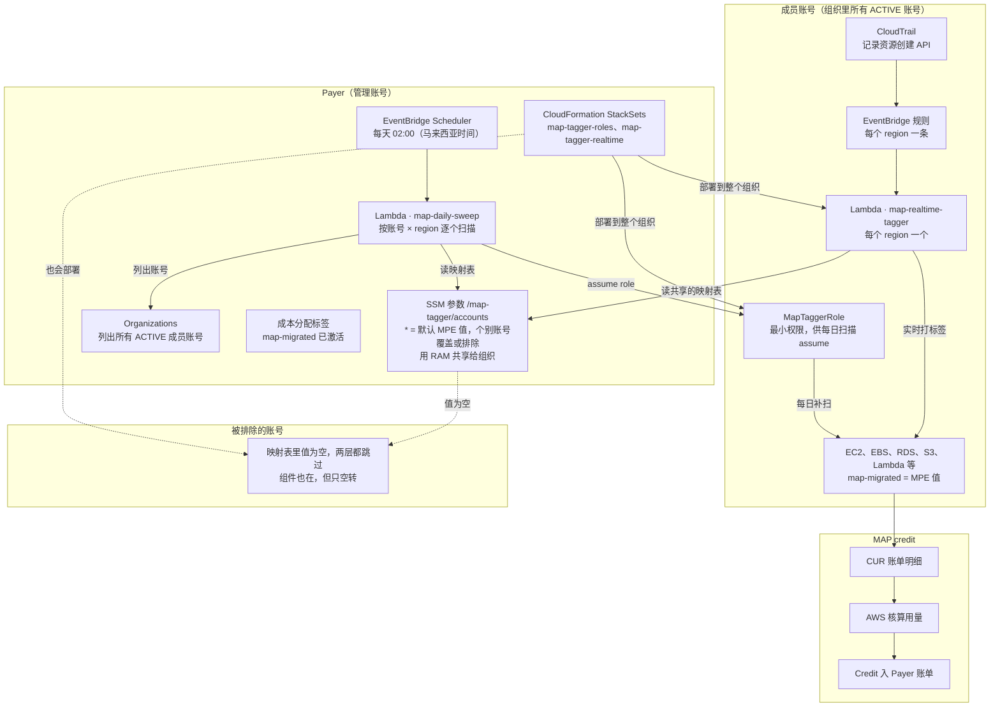

# 部署与运维指南

本文档说明怎么按“实时打标签 + 每日扫描兜底”的方案部署 org-tagger：

- Payer（管理账号）里的部分在控制台手动配置一次，见第 2 步。
- 成员账号里的部分用 CloudFormation StackSets 部署到整个组织并打开自动部署：已有的、以后新加入组织的账号都会自动部署好，不用逐个登录，见第 3 步。模板在 `templates/` 目录下。
- 默认所有成员账号的资源都打标签。每个账号打什么值，由账号映射表决定：`"*"` 是所有成员账号的默认值，个别账号可以单独写一行用别的值，值留空就是排除这个账号。新账号加入组织后什么都不用做。

全部用 Lambda，不需要服务器。两个函数的工作原理、环境变量和日志字段见 [README.md](README.md)。

## 部署架构



- **实时层**：资源一创建，CloudTrail 事件就触发同账号、同 region 的 Lambda。它从共享过来的映射表里查出本账号该打的值，几分钟内打上标签。
- **每日扫描**：Payer 里的 Lambda 每天读一次映射表，从 Organizations 列出所有 ACTIVE 的成员账号，assume 进每个账号的 `MapTaggerRole`，把实时层漏掉的补上。
- **账号映射表**：两层读的是同一个 SSM 参数，规则也一样。`"*"` 是所有成员账号的默认值；个别账号单独写一行就用自己的值；值留空表示排除。Payer 自己不吃 `"*"`，要处理就单独写一行。
- **StackSets**：把 `MapTaggerRole`、实时层的执行角色、实时层 Lambda 和 EventBridge 规则部署到组织里的每个成员账号。被排除的账号里也有这些组件，只是空转：实时层只记 `SKIP`，每日扫描也不会去。
- **MAP credit**：带标签的用量出现在 CUR 账单明细里，AWS 按 MPE 值核算，credit 发到 Payer 的合并账单。标签不追溯，所以越早打上越好。

| 在哪里做 | 做什么 | 频率 |
| --- | --- | --- |
| Payer（管理账号） | 确认成本分配标签；创建并共享映射表；创建扫描 Lambda 和它的执行角色；创建两个 StackSet；设置每日定时任务 | 一次 |
| 成员账号 | 由 StackSets 自动部署，不用登录操作；只需确认有 CloudTrail trail | 账号加入组织时自动部署 |
| 扫描 Lambda（在 Payer 里） | 补上实时层漏掉的 | 每天 02:00 |
| 实时层 Lambda（在每个成员账号里） | 资源创建后几分钟内打标签；被排除的账号只记 `SKIP` | 随时，由事件触发 |

## 实施顺序

1. [确认前置条件](#1-前置条件)
2. [Payer 账号配置](#2-payer-账号配置)：成本分配标签、映射表及其共享、扫描 Lambda
3. [用 StackSets 部署到整个组织](#3-用-stacksets-部署到整个组织)：这时映射表里只有一个测试账号，用它验证实时层
4. [首次上线](#4-首次上线)：试跑、把映射表改成 `"*"` 默认值、全量 dry-run、审日志、两层一起切到 apply、设置每天定时
5. 进入[日常运维](#5-日常运维与常见问题)

第 3 步依赖第 2 步：`MapTaggerRole` 的信任策略要引用扫描 Lambda 的执行角色，实时层要用共享映射表的 ARN。

## 1. 前置条件

开工前把下面几项逐一确认，其中标签值和 Organizations 的功能集最关键：前者决定打什么值，后者决定能不能用 StackSets 和 RAM 共享。

- [ ] 确定标签 key 和 value。MAP 项目的 key 固定为全小写 `map-migrated`，value 用 MAP 协议对应的 MPE 值（例如 `migXXXXXXXXXX`）。
- [ ] 确定默认的 MPE 值，以及有没有账号要用别的值、或者不该打标签（例如不属于 MAP 的客户账号）。这就是 [2.2](#22-创建账号映射表) 映射表的内容。
- [ ] 确认组织里所有成员账号都可以放 StackSets 下发的资源：两个角色和实时层 Lambda。不能放的账号所在的 OU，在第 3 步就不要选进部署目标，改成按 OU 部署。
- [ ] Organizations 开启了全部功能（All features）。只开了合并账单功能的组织，既不能用服务托管的 StackSets，也不能用 RAM 共享给组织。
- [ ] Payer 上有一个管理员身份，用来创建 IAM 角色、Lambda、SSM 参数、RAM 共享、StackSets 和 Scheduler。
- [ ] Payer 已开启 Cost Explorer（MAP 必需）。
- [ ] SCP 不阻止 StackSets 的执行角色（`stacksets-exec-` 开头）创建 IAM 角色、Lambda 和 EventBridge 规则。
- [ ] 有客户账号的，要先获得授权，并告知对方：StackSets 会在其账号里建 `MapTaggerRole`（信任 Payer 里的扫描 Lambda，只能读标签和打标签）和实时层的 Lambda。
- [ ] 所有成员账号都有一条正在记录管理事件的 CloudTrail trail，组织级 trail 可以一次覆盖，见 [3.1](#31-确认-cloudtrail-在记录)。
- [ ] 选定 Payer 里放扫描 Lambda 的 region，例如 `ap-southeast-1`。映射表、扫描 Lambda、定时任务和 StackSets 都在这个 region 里操作。
- [ ] 从本仓库取得 `sweep_tagger.py` 和 `templates/` 下的两个模板。
- [ ] 如果之前在某些账号里手动建过 `MapTaggerRole`、`MapRealtimeTaggerRole` 或 `map-realtime-tagger`，先删掉，否则 StackSet 会因为同名资源已存在而失败。

在 Payer 的 CloudShell 里可以列出所有账号，方便确认哪些要排除或用别的值：

```bash
aws organizations list-accounts \
  --query "Accounts[].[Id,Name,Status]" --output table
```

## 2. Payer 账号配置

以下都在 Payer 里、在选定的 region 里操作（控制台右上角切换 region）。

### 2.1 确认成本分配标签

进入 Billing and Cost Management → Cost allocation tags，在 User-defined cost allocation tags 里搜索 `map-migrated`：

- 状态是 Active，不用做任何事。MAP 的 `map-migrated` 一般会自动激活。
- 状态是 Inactive，勾选后点 Activate。
- 搜不到：新 key 要在资源上打过之后才会出现在列表里，出现和生效都可能要等最多 24 小时。等实时层或首次扫描打上标签后再来确认。

### 2.2 创建账号映射表

1. 进入 Systems Manager → Parameter Store → Create parameter。
2. Name 填 `/map-tagger/accounts`；Tier 选 **Advanced**；Type 选 String；Data type 选 text。
3. Value 先只填一个测试账号，点 Create parameter：

   ```json
   {
     "111122223333": "migXXXXXXXXXX"
   }
   ```

第 4 步验证通过后，再改成正式的内容，例如：

```json
{
  "*": "migXXXXXXXXXX",
  "444455556666": "migYYYYYYYYYY",
  "777788889999": ""
}
```

| key | 含义 |
| --- | --- |
| `"*"` | 所有 ACTIVE 成员账号的默认值。每日扫描从 Organizations 列出这些账号，以后新加入组织的账号自动包含在内 |
| 12 位账号 ID | 这个账号用自己的值，覆盖 `"*"` |
| 账号 ID，值为 `""` | 排除这个账号，两层都不处理 |

- `"*"` 不包括 Payer 自己。Payer 里也有要打标签的资源时，单独写一行 Payer 的账号 ID，并按 [3.7](#37-payer-自己的资源) 部署。
- 选 Advanced 是因为只有高级参数能跨账号共享（2.3）。高级参数每个每月 0.05 美元，上限 8 KB；表里只写例外的账号，一般用不完。
- 以后改表：打开这个参数点 Edit，改完点 Save changes。每日扫描下一次运行时生效，实时层最多 5 分钟后生效。

### 2.3 把映射表共享给组织

RAM 共享是按 region 的：下面的操作必须在映射表参数所在的 region（2.2 建参数时的 region）里做。建在别的 region，成员账号会读不到映射表。

1. 进入 Resource Access Manager → Settings，勾选 Enable sharing with AWS Organizations，点 Save settings。已经开启的话跳过。
2. 进入 Resource Access Manager → Resource shares → Create resource share。
3. Name 填 `map-tagger-accounts`。Resources 里的资源类型选 Parameter Store Advanced Parameter，勾选 `/map-tagger/accounts`。点 Next。
4. Managed permissions 选 `AWSRAMDefaultPermissionSSMParameterReadOnly`（只读）。点 Next。
5. Principals 保持 Allow sharing only within your organization，选整个组织。每个成员账号里的实时层都要读得到映射表，读不到会报错。点 Next，确认后点 Create resource share。
6. 回到 Systems Manager → Parameter Store，打开 `/map-tagger/accounts`，记下它的完整 ARN，形如 `arn:aws:ssm:ap-southeast-1:<Payer账号ID>:parameter/map-tagger/accounts`。第 3 步要用。
7. 验证共享：在任意一个成员账号的 CloudShell 里运行下面的命令（region 和 ARN 换成实际值），能打印出映射表的内容就说明共享生效了。刚建好的共享可能要等几分钟。

   ```bash
   aws ssm get-parameter --region ap-southeast-1 --name arn:aws:ssm:ap-southeast-1:<Payer账号ID>:parameter/map-tagger/accounts --query Parameter.Value --output text
   ```

   如果报 AccessDeniedException，并且写着 no resource-based policy allows the ssm:GetParameter action，说明共享没生效。依次检查：参数的 Tier 是不是 Advanced；共享是不是建在参数所在的 region；Settings 里有没有开启 Enable sharing with AWS Organizations；共享的 Principals 是不是整个组织，状态是不是 Associated。

在 Payer 的 CloudShell 里也可以检查共享的状态：

```bash
aws ram get-resource-share-associations --association-type PRINCIPAL --region ap-southeast-1 --query "resourceShareAssociations[].[resourceShareName,associatedEntity,status]" --output table
```

### 2.4 创建扫描 Lambda 的执行角色

1. 进入 IAM → Roles → Create role。
2. Trusted entity type 选 AWS service，Use case 选 Lambda，点 Next。
3. 搜索并勾选 `AWSLambdaBasicExecutionRole`（写 CloudWatch 日志用），点 Next。
4. Role name 填 `MapSweepLambdaRole`，点 Create role。
5. 打开刚建好的角色，在 Permissions 页签点 Add permissions → Create inline policy，切到 JSON，粘贴下面的策略，把 `<region>` 和 `<Payer账号ID>` 换成实际值。点 Next，Policy name 填 `MapSweep`，点 Create policy。

```json
{
  "Version": "2012-10-17",
  "Statement": [
    {
      "Sid": "ReadMapping",
      "Effect": "Allow",
      "Action": "ssm:GetParameter",
      "Resource": "arn:aws:ssm:<region>:<Payer账号ID>:parameter/map-tagger/accounts"
    },
    {
      "Sid": "ListAccounts",
      "Effect": "Allow",
      "Action": "organizations:ListAccounts",
      "Resource": "*"
    },
    {
      "Sid": "AssumeMapTaggerRole",
      "Effect": "Allow",
      "Action": "sts:AssumeRole",
      "Resource": "arn:aws:iam::*:role/MapTaggerRole"
    },
    {
      "Sid": "FanOut",
      "Effect": "Allow",
      "Action": "lambda:InvokeFunction",
      "Resource": "arn:aws:lambda:<region>:<Payer账号ID>:function:map-daily-sweep"
    }
  ]
}
```

四段权限分别用来读映射表、列出组织里的账号、进入各账号的 `MapTaggerRole`，以及按“账号 × region”异步调用函数自己。这个角色本身不能读写任何资源的标签，真正干活的权限在各账号的 `MapTaggerRole` 里。

这个角色建好后不要删掉重建：各账号 `MapTaggerRole` 的信任策略认的是它，重建后就对不上了。

### 2.5 创建扫描 Lambda

1. 进入 Lambda → Functions → Create function，选 Author from scratch。
2. Function name 填 `map-daily-sweep`；Runtime 选列表里最新的 Python 3（3.12 或以上）；Architecture 保持默认。
3. 展开 Change default execution role，选 Use an existing role，再选 `MapSweepLambdaRole`。点 Create function。
4. 在 Code 页签打开 `lambda_function.py`，删掉里面的示例代码，把本仓库 `sweep_tagger.py` 的全部内容粘贴进去，点 Deploy。Handler 保持默认的 `lambda_function.lambda_handler`。
5. 在 Configuration 页签 → General configuration 点 Edit：Memory 改成 256 MB，Timeout 改成 15 min 0 sec（Lambda 的上限）。点 Save。
6. 在 Configuration 页签 → Environment variables 点 Edit，添加 `MODE`，值填 `dryrun`，点 Save。其它变量用默认值即可。如果只想扫用到的几个 region，再加 `REGIONS`，例如 `ap-southeast-1,ap-southeast-5,us-east-1`。所有变量见 [README](README.md#环境变量-1)。
7. 在 Configuration 页签 → Concurrency 点 Edit，选 Reserve concurrency，填 `10`，点 Save。它限制同时运行的扫描数量，避免触发各服务的 API 限流；超出的调用会自动排队等待。如果提示账号的并发额度不够，可以先跳过这一步。

先保持 `MODE=dryrun`，第 4 步审完日志再改成 `apply`。每天定时运行也在第 4 步最后设置。

## 3. 用 StackSets 部署到整个组织

两个 StackSet，模板都在本仓库的 `templates/` 下：

| StackSet | 模板 | 内容 | 部署到哪些 region |
| --- | --- | --- | --- |
| `map-tagger-roles` | `map-tagger-roles.yaml` | `MapTaggerRole` 和实时层的执行角色 `MapRealtimeTaggerRole` | 只选一个（IAM 是全局的） |
| `map-tagger-realtime` | `map-tagger-realtime.yaml` | 实时层 Lambda `map-realtime-tagger` 和 EventBridge 规则 | 每个有资源的 region，一定包含 us-east-1 |

- 两个 StackSet 都部署到整个组织，并打开自动部署：以后新加入组织的账号会自动部署，离开组织时自动删除。
- `map-tagger-realtime` 设一个依赖，指向 `map-tagger-roles`：自动部署新账号时先建角色、再建 Lambda。
- 模板由 `make_templates.py` 生成，实时层的代码直接内联在模板里。改了 `realtime_tagger.py` 后，先运行 `python make_templates.py` 重新生成，再更新 StackSet。
- 服务托管的 StackSets 不会部署到管理账号。Payer 自己的资源按 [3.7](#37-payer-自己的资源) 单独部署。
- 以下 StackSets 操作都在 Payer 的 CloudFormation 控制台、在选定的 region 里进行。StackSet 只在创建它的那个 region 里看得到，以后修改也要先把控制台切到那个 region。

### 3.1 确认 CloudTrail 在记录

实时层靠 CloudTrail 把 API 调用投递到 EventBridge。账号里没有正在记录的 trail，规则永远不会触发。

在 Payer 的 CloudTrail 控制台 → Trails 里，看有没有一条组织级 trail（Trail type 是 Organization）同时满足：

- Status 是 Logging；
- Multi-region trail 是 Yes；
- 记录 Management events，并且包含 Write。

如果没有，建一条，一次覆盖所有账号和 region：

1. 在 Payer 进入 CloudTrail → Trails → Create trail。
2. 填一个 Trail name，勾选 Enable for all accounts in my organization。
3. Storage location 选 Create new S3 bucket。Log file SSE-KMS encryption 默认勾选，要么填一个新的 KMS 别名，要么取消勾选。点 Next。
4. Event type 勾选 Management events，API activity 保持 Read 和 Write 都勾选。点 Next，再点 Create trail。

每个账号第一份管理事件的记录不收费，只付 S3 存储费。

实际部署已经验证：组织级 trail 能触发成员账号里的 EventBridge 规则，成员账号不用自己再建 trail。

### 3.2 开通 StackSets 的信任访问

在 Payer 进入 CloudFormation → StackSets。如果页面顶部有提示要开通信任访问，点 Activate trusted access。看到开通成功的提示即可，已经开通过的话没有这个提示。

### 3.3 创建 StackSet map-tagger-roles

1. 在 CloudFormation → StackSets 点 Create StackSet。
2. Permissions 选 Service-managed permissions；Prerequisite - Prepare template 选 Template is ready；Specify template 选 Upload a template file，上传 `templates/map-tagger-roles.yaml`。点 Next。
3. StackSet name 填 `map-tagger-roles`。Parameters：
   - `PayerAccountId`：Payer 的账号 ID；
   - `MappingParameterArn`：2.3 记下的映射表 ARN；
   - `TagKey`：保持 `map-migrated`。

   点 Next。
4. Execution configuration 选 Active。Capabilities 勾选 I acknowledge that this template may create IAM resources。点 Next。
5. Set deployment options 页：
   - Deployment targets 选 Deploy to organization。如果前置条件里确定有些账号不能放这些资源，改选 Deploy to organizational units (OUs)，只填可以放的 OU。OU ID（`ou-` 开头）和组织根 ID（`r-` 开头）在 Organizations 控制台的 AWS accounts 页能看到，组织根 ID 也可以在 CloudShell 里用 `aws organizations list-roots --query "Roots[0].Id" --output text` 查。
   - Automatic deployment 选 Activated；Account removal behavior 选 Delete stacks，账号离开组织（或移出目标 OU）时自动删掉这些资源。
   - Specify regions 只选一个 region，例如 `ap-southeast-1`。
   - Deployment options：Maximum concurrent accounts 选 Percentage 填 `100`；Failure tolerance 选 Percentage 填 `100`；Region concurrency 选 Parallel；Concurrency mode 选 Soft failure tolerance。默认设置是一次一个账号、失败容忍度为 0：某个 region 失败一多，这个 region 里后面的账号会被连带取消（CANCELLED），整个操作还会停下，不再处理后面的 region。这两个 StackSet 的资源很少，账号之间互不影响，全部同时部署没问题。

   点 Next。
6. 在 Review 页确认部署目标和 region，点 Create StackSet。

创建后会马上部署到所有成员账号。这时映射表里只有测试账号，其它账号里的组件不会做任何事。

在 StackSet 的 Stack instances 页签里，状态变成 CURRENT 就是部署成功。失败时看 Status reason：

- **Invalid principal**：Payer 里的 `MapSweepLambdaRole` 还没建，或者 `PayerAccountId` 填错了。
- **already exists**：该账号里已有同名角色，先删掉再重试。
- **should enable &lt;region&gt; and have 'stacksets-exec-…' role**：该账号没有启用这个 opt-in region（如 af-south-1、ap-east-1），StackSets 部署不进去。属正常，可以不管：账号里没启用的 region 也不会有资源。后半句提到的角色是这类报错的固定写法，不是真的缺角色。
- **Cancelled since failure tolerance has exceeded**：本身没问题，是被别的失败连带取消的。按上面第 5 步的部署选项，用 [3.9](#39-修改-stackset) 再提交一次即可。

个别账号失败不影响其它账号。修好原因后，按 [3.9](#39-修改-stackset) 用当前模板再提交一次，失败和被取消的实例会重新部署。

### 3.4 创建 StackSet map-tagger-realtime

要等 `map-tagger-roles` 的部署全部完成之后再做，因为实时层 Lambda 要用它建的执行角色。

1. 在 CloudFormation → StackSets 点 Create StackSet。
2. Permissions 选 Service-managed permissions；上传 `templates/map-tagger-realtime.yaml`。点 Next。
3. StackSet name 填 `map-tagger-realtime`。Parameters：
   - `MappingParameterArn`：2.3 记下的映射表 ARN；
   - `TagKey`：保持 `map-migrated`；
   - `Mode`：先保持 `dryrun`。

   点 Next。
4. Execution configuration 选 Active。点 Next。
5. Set deployment options 页：
   - Deployment targets、Automatic deployment、Account removal behavior 都和 3.3 一样。
   - StackSet dependencies 里填 `map-tagger-roles` 的 StackSet ARN，在它的 StackSet info 页签能看到。以后自动部署到新账号时，会先建好角色再建 Lambda。
   - Specify regions 选所有有资源的 region，**一定要包含 us-east-1**：CloudFront 是全局服务，它的创建事件只出现在 us-east-1。不确定有哪些 region，可以看 Billing → Bills 里按 region 列出的费用。可以包含 opt-in region，没启用它的账号会 FAILED，属正常（见 3.3）。
   - Deployment options 同 3.3。

   点 Next。
6. 在 Review 页确认，点 Create StackSet，等 Stack instances 都变成 CURRENT。

### 3.5 用测试资源验证

这时映射表里只有测试账号。以下在测试账号里操作：

1. 在一个部署了实时层的 region 建一个测试资源。最省钱的是一个 1 GiB 的 gp3 EBS 卷（EC2 → Volumes → Create volume），或者一个空的 S3 桶。
2. 等 1–5 分钟，打开 Lambda → `map-realtime-tagger` → Monitor 页签 → View CloudWatch logs，进入最新的 log stream。应该能看到一行 `"action": "WOULD_TAG"`，`resource` 是测试资源的 ID。
3. 删掉测试资源。

CloudTrail 事件投递到 EventBridge 一般要几分钟，偶尔会到 10 到 15 分钟。

Lambda 的日志组 `/aws/lambda/map-realtime-tagger` 要等函数第一次运行时才会建出来。还没被触发过的 region 里，Monitor 页签或 CloudWatch 会提示日志组不存在（Log group does not exist），这是正常的。

看不到日志时，按顺序排查：

1. 确认你看的 region 就是测试资源所在的 region。日志组是按 region 分开的。
2. 进入 EventBridge → Rules → `map-realtime-tagger` 的 Monitoring 页签，看 Invocations 有没有数字。没有说明规则没触发：检查 3.1 的 trail，以及这个账号、这个 region 的 stack 实例是否部署成功。
3. 有 Invocations 但 Lambda 没有日志：看规则的 FailedInvocations 和 Lambda Monitor 页签里的 Errors。
4. 日志里是 `"action": "SKIP"`：检查映射表里测试账号那一行。日志里报 AccessDeniedException，并且写着 no resource-based policy allows the ssm:GetParameter action：映射表的 RAM 共享没生效，按 2.3 第 7 步检查。

也可以在 Lambda 的 Test 页签手动调用一次，单独确认 Lambda、角色和读映射表都正常。把下面的账号、region 和卷 ID 换成实际值，点 Test，Response 和日志里应该是 `WOULD_TAG`：

```json
{
  "account": "111122223333",
  "region": "ap-southeast-1",
  "detail": {
    "eventSource": "ec2.amazonaws.com",
    "eventName": "CreateVolume",
    "awsRegion": "ap-southeast-1",
    "recipientAccountId": "111122223333",
    "responseElements": {"volumeId": "vol-xxxxxxxx"}
  }
}
```

再在另一个成员账号里建一个测试资源。它这时既不在映射表里、表里也还没有 `"*"`，所以那里的实时层日志应该是 `"action": "SKIP"`。这说明被排除的账号里组件确实只空转。删掉这个测试资源。

正式打标签放在第 4 步，和每日扫描一起切换。

### 3.6 新账号和新 region

- **新加入组织的账号**：StackSets 会自动部署，映射表里的 `"*"` 也会自动覆盖它，什么都不用做。要用别的值或者排除它，在映射表里单独写一行。
- **新的 region**：在 `map-tagger-realtime` 上点 Actions → Add stacks to StackSet，部署目标和之前一样，region 只选新的，部署选项同 3.3。完成后在 Stack instances 页签确认每个账号都有这个 region 的实例。
- **账号以后启用了某个 opt-in region**：这个账号在该 region 的实例之前是 FAILED，不会自动重试。按 [3.9](#39-修改-stackset) 再提交一次（region 里选上它），就会部署上去。

### 3.7 Payer 自己的资源

服务托管的 StackSets 不会部署到管理账号，映射表里的 `"*"` 也不包括 Payer。如果 Payer 里也有要打标签的资源：

1. **角色**：在 Payer 进入 CloudFormation → Stacks → Create stack → With new resources (standard)，上传 `templates/map-tagger-roles.yaml`。Stack name 填 `map-tagger-roles`，参数同 3.3。Configure stack options 页全部保持默认，只需勾选最下面 Capabilities 里的 IAM 确认，创建。只需在一个 region 建。
2. **实时层**：普通栈是按 region 分开的，在控制台只能每个 region 切过去建一次。用 CloudShell 可以一次建完：打开 Payer 的 CloudShell，点 Actions → Upload file 上传 `templates/map-tagger-realtime.yaml`，然后运行下面的命令（ARN 换成 2.3 记下的）。它会对 Payer 已启用的每个 region 同时部署，几分钟就能跑完。

   ```bash
   for r in $(aws ec2 describe-regions --region us-east-1 --query "Regions[].RegionName" --output text); do (aws cloudformation deploy --region "$r" --stack-name map-tagger-realtime --template-file map-tagger-realtime.yaml --parameter-overrides MappingParameterArn=<映射表ARN> Mode=dryrun --no-fail-on-empty-changeset > "deploy-$r.log" 2>&1; echo "$r: exit $?") & done; wait
   ```

   - 开头会打印一串 `[1] 307` 这样的行，那是 bash 报告后台任务已启动，正常。
   - 每个 region 结束时打印 `exit 0`（成功）或其它数字（失败），失败原因在当前目录的 `deploy-<region>.log` 里。已经建好的 region 会直接跳过，所以可以重复运行。
   - 跑完后用下面的命令确认各 region 都是 `CREATE_COMPLETE`：

   ```bash
   for r in $(aws ec2 describe-regions --region us-east-1 --query "Regions[].RegionName" --output text); do echo "$r: $(aws cloudformation describe-stacks --region "$r" --stack-name map-tagger-realtime --query 'Stacks[0].StackStatus' --output text 2>&1)"; done
   ```

   - 某个 region 是 `ROLLBACK_COMPLETE` 的话，先看日志里的原因，再用 `aws cloudformation delete-stack --region <region> --stack-name map-tagger-realtime` 删掉，然后对这个 region 重跑。
   - 日志里是 Connect timeout on endpoint URL，说明 CloudShell 连不上那个 region 的接口，栈根本没建；多半是那个 region 自身的问题，见第 5 步常见问题。
3. 在映射表里单独写一行 Payer 的账号 ID 和要打的值。

以后要改 Payer 里的实时层（切 `Mode`、更新代码），都用上面同一个循环，改参数或换新模板后再跑一次。

### 3.8 和账号负责人确认

- **SCP**：作用于该账号的 SCP 不能拒绝打标签相关的操作，也不能拒绝资源所在的 region。SCP 对管理账号不生效。
- **IaC 管理的资源**：Terraform 或 CloudFormation 管理的资源，要同步把标签写进代码（Terraform 可用 provider 的 `default_tags`），否则下次部署可能把打上的标签抹掉。
- **以后新建的实例**：在启动模板里加上标签，或在 Auto Scaling 组的标签上设 `PropagateAtLaunch=true`。实时层和每日扫描都会补，但从源头加上最可靠。

### 3.9 修改 StackSet

切换 `Mode`、更新模板、重试失败或被取消的实例，都用同一个操作。先把控制台切到创建 StackSet 的那个 region：

1. 进入 CloudFormation → StackSets，点要改的 StackSet，右上角 Actions → Edit StackSet details。
2. Choose a template：只改参数或重试时选 Use current template；更新代码或权限时选 Replace current template，上传 `make_templates.py` 新生成的模板。
3. Specify StackSet details：要改的参数在这里改（例如 `Mode`），其它保持不变。
4. Configure StackSet options：保持不变。
5. Set deployment options：
   - Deployment targets 和创建时一样（Deploy to organization，或者同样的 OU）。
   - Specify regions 选这个 StackSet 现有的全部 region。只有选中的 region 会被更新或重试。
   - Deployment options 同 3.3：并发和失败容忍度都填 Percentage 100，Region concurrency 选 Parallel，Concurrency mode 选 Soft failure tolerance。
6. Review 页确认后点 Submit，在 Operations 页签看进度。

这个操作只更新已有的实例，不会增加 region。要加 region 用 Actions → Add stacks to StackSet（见 3.6）。

## 4. 首次上线

前提：第 2、3 步做完，映射表里有测试账号。每日扫描的操作都在 Payer 的 Lambda → `map-daily-sweep` 里进行。

1. **单账号试跑**：确认环境变量 `MODE` 是 `dryrun`。在 Test 页签新建一个测试事件，Event JSON 填下面的内容，点 Test。执行结果的 Response 里是各 action 的数量，Log output 里是逐个资源的日志。再把 `region` 改成 `global` 试一次，检查 S3 和 CloudFront。

   ```json
   {"account": "<测试账号ID>", "region": "ap-southeast-1"}
   ```

2. **把映射表改成正式内容**：编辑 2.2 的参数，加上 `"*"` 和默认的 MPE 值；要用别的值或要排除的账号各写一行。测试账号那一行如果和默认值一样，可以删掉。这时两层都还是 dry-run，不会改动任何资源。
3. **全量 dry-run**：把测试事件改成 `{}`，点 Test。返回 `{"accounts": N, "jobs": M}` 表示要处理 N 个账号，已经在后台发起了 M 次扫描调用。等它们全部跑完：Monitor 页签里的 Concurrent executions 回到 0，或者 Logs Insights 里的日志不再增加。一般十几分钟到半小时，视账号和 region 的多少而定。
4. **审日志**：按下面的[审日志](#审日志)看一遍。`WOULD_TAG` 里有不该打标签的账号，在映射表里把它的值设成 `""`；`CONFLICT` 要确认已有的值该不该覆盖；`ERROR` 里 `type` 为 `assume_role` 的，通常是 StackSets 还没部署到这个账号。
5. **三处一起切到正式执行**：
   - 每日扫描：把环境变量 `MODE` 改成 `apply`，再用 `{}` 点一次 Test。跑完后用 Logs Insights 确认 `TAGGED` 的数量和 dry-run 时 `WOULD_TAG` 的数量对得上。
   - 成员账号的实时层：按 [3.9](#39-修改-stackset) 修改 `map-tagger-realtime`，选 Use current template，把 `Mode` 改成 `apply`。
   - Payer 的实时层（如果按 3.7 部署了）：把 3.7 那个循环里的 `Mode=dryrun` 改成 `Mode=apply` 再跑一次。

   完成后在测试账号里建一个测试资源，几分钟后它的 Tags 页签里应该出现 `map-migrated`，日志里是 `"action": "TAGGED"`。最后删掉测试资源。
6. **设置每天定时运行**：按下面的[设置每天定时运行](#设置每天定时运行)建定时任务。
7. **复查**：第二天定时任务跑完后再看一次日志。理想情况下只剩 `OK`、少量 `TAGGED` 和你决定保留的 `CONFLICT`；出现 `FAILED` 或 `ERROR`，按[第 5 步](#5-日常运维与常见问题)处理。

### 审日志

进入 CloudWatch → Logs Insights，日志组选 `/aws/lambda/map-daily-sweep`，时间范围要覆盖这次运行。先按账号和 action 汇总：

```
filter ispresent(action)
| stats count(*) as n by account_id, action
| sort account_id asc
```

再看需要关注的明细：

```
fields account_id, region, type, resource, current_value, action, detail
| filter action in ["WOULD_TAG", "CONFLICT", "FAILED", "ERROR"]
| sort account_id asc
| limit 10000
```

需要用 Excel 看的话，点结果上方的 Export results → Download table (CSV)。Logs Insights 一次最多返回 10,000 行，超过就加一行 `| filter account_id = "111122223333"` 按账号分开导出。

另外再做三项检查：

- **账号数对不对**：没有任何资源的账号不会出现在汇总里，要对一下调度的账号数。下面查询的 `detail` 里的“N 个账号”，应该等于组织里 ACTIVE 成员账号数，减去排除的账号，再加上单独写进表里的 Payer。

  ```
  filter action = "DISPATCHED"
  | fields @timestamp, detail
  ```

- **要打标签的是哪些资源**：按类型拆开看。其中会有 org-tagger 自己部署的资源，比如各 region 的 `map-realtime-tagger` Lambda，以及第二层补扫可能找到的 EventBridge 规则。它们几乎不产生费用，打上标签也没关系。

  ```
  filter action = "WOULD_TAG"
  | stats count(*) as n by type
  | sort n desc
  ```

- **有没有扫描超时**：某个 region 连不上时，那次扫描调用会一直等到 15 分钟上限被强制结束，汇总里只会留下一两行 `ERROR`。

  ```
  filter @message like /Task timed out/
  | fields @timestamp, @logStream
  ```

| action | 含义 | 怎么处理 |
| --- | --- | --- |
| `OK` | 已经是正确的值 | 不用处理 |
| `WOULD_TAG` | dry-run 时表示会被打上 | 审一遍；有不该打标签的账号，在映射表里把它的值设成 `""` |
| `TAGGED` | 本次已打上 | 实时层上线后，每天扫描出的 `TAGGED` 就是实时层漏掉的；数量多要查实时层 |
| `CONFLICT` | 已有同名 key 但值不同，没有改动 | 确认要覆盖时，临时把 `OVERWRITE` 设成 `true` 跑一次，跑完改回去 |
| `FAILED` | 单个资源打标签失败 | 看 `detail`，按[常见问题](#5-日常运维与常见问题)处理 |
| `ERROR` | 整个服务或账号出错，例如 assume role 失败 | 看 `type` 和 `detail`，按[常见问题](#5-日常运维与常见问题)处理 |
| `DISPATCHED` | 调度完成 | 看 `detail` 里的账号数和扫描次数是否符合预期 |

### 设置每天定时运行

1. 进入 Amazon EventBridge → Scheduler → Schedules → Create schedule。
2. Schedule name 填 `map-daily-sweep`，Schedule group 保持 default。
3. Schedule pattern 选 Recurring schedule，Schedule type 选 Cron-based schedule，cron 表达式填 `0 2 * * ? *`（每天 02:00）。Flexible time window 选 Off。
4. Timeframe 的 Time zone 选 `Asia/Kuala_Lumpur`，开始和结束时间留空。点 Next。
5. Target 选 Templated targets 里的 AWS Lambda Invoke，Lambda function 选 `map-daily-sweep`，Payload 填 `{}`。点 Next。
6. Settings 页的 Retry policy 保持默认；Permissions 选 Create new role for this schedule。点 Next，确认后点 Create schedule。

## 5. 日常运维与常见问题

上线后日常主要看每日扫描的日志：每天扫描出的 `TAGGED` 都是实时层漏掉的，数量突然变多，多半是某个账号或 region 的实时层出了问题。下表是最常遇到的情况和处理方法。

| 情况 | 处理方法 |
| --- | --- |
| 新账号加入组织 | 什么都不用做：StackSets 自动部署，`"*"` 自动覆盖。要用别的值或排除它，在映射表里单独写一行 |
| 某个账号不该打标签 | 在映射表里写一行，值设成 `""`，两层都会跳过它（实时层最多 5 分钟后生效）。StackSets 部署的资源留在那里只空转；连这些资源也不想要，就把账号移到不在部署目标里的 OU，并把部署目标改成按 OU |
| 新账号第一天出现 `ERROR`，`type` 为 `assume_role` | 账号刚加入组织，扫描时 StackSets 还没部署完，第二天会恢复。持续出现就看 StackSets 的 Operations 页签 |
| 实时层报 AccessDeniedException：no resource-based policy allows the ssm:GetParameter action | 映射表的 RAM 共享没生效。按 2.3 第 7 步检查：参数是不是 Advanced、共享是不是建在参数所在的 region、是不是共享给了整个组织 |
| Lambda 的 Monitor 页签或 CloudWatch 提示日志组不存在 | 函数在这个 region 还没被触发过，日志组要第一次运行时才会建出来，属正常。建个测试资源触发一次就会出现 |
| StackSet 实例 FAILED：should enable &lt;region&gt; | 该账号没启用这个 opt-in region，属正常，可以不管。账号以后启用了它，按 [3.9](#39-修改-stackset) 再提交一次就会部署上去 |
| StackSet 实例 CANCELLED：Cancelled since failure tolerance has exceeded | 被别的失败连带取消。按 3.3 的部署选项（并发和失败容忍度都填 100%、Soft 模式），用 [3.9](#39-修改-stackset) 再提交一次 |
| 某个 region 报 Connect timeout on endpoint URL | 连不上那个 region 的接口，多半是 region 本身的问题，可以在 AWS Health Dashboard 确认。部署时出现：等恢复后对这个 region 重跑。每日扫描时出现：那个 region 会有 `ERROR`，扫描调用还会因超时被强制结束；长期如此的话，给扫描 Lambda 设 `REGIONS`，只列要扫的 region |
| 标签值要改（例如换 MPE 值） | 改映射表里 `"*"` 或该账号的值。旧值会显示为 `CONFLICT`，确认要覆盖时，临时把扫描 Lambda 的 `OVERWRITE` 设成 `true` 跑一次，跑完改回 `false`，避免以后误覆盖别人打的值 |
| `ERROR`，`type` 为 `assume_role`，`region` 为 `-` | 该账号没有 `MapTaggerRole`：StackSets 没部署到它（部署目标没覆盖、或部署失败），或者部署时 `PayerAccountId` 填错了。如果 Payer 里的 `MapSweepLambdaRole` 被删掉重建过，要在 `map-tagger-roles` 里把 stack 实例删掉再重新添加，让信任策略重新指向新角色；期间实时层会因为执行角色不存在而报错，重新添加后恢复 |
| `ERROR`，`type` 为 `assume_role`，`region` 是具体 region | 调度时能进入、扫描时进不去，多半是 STS 限流，下次运行会补上。连续几天都出现，再按上一行检查 |
| `ERROR`，`type` 为 `mapping` | 映射表里有格式不对的 key：要么是 `"*"`，要么是 12 位账号 ID |
| `ERROR`，`type` 为 `h_xxx` | 该服务在这个 region 不可用、没开通，或者被 SCP 拒绝，看 `detail`。不在用的 region 每天都报的话，可以用 `REGIONS` 只扫用到的 region |
| `FAILED`，`detail` 含 AccessDenied | 多半是 SCP 拒绝。`MapTaggerRole` 已包含约 320 个服务的打标签权限；如果确实是新服务不在列表里，把它加进 `make_templates.py` 的 `SWEEP_TAG_ACTIONS`，重新生成模板，按下面“更新模板”的方法更新 `map-tagger-roles` |
| 某类资源一直没出现在日志里 | 它不在第一层的类型里，而且从没打过任何标签。手动给它打一次任意标签，之后的补扫就能覆盖到；或者在代码里照格式加一个 `h_xxx` 函数（见 [README](README.md#增加资源类型)） |
| 标签打上后又消失 | 多半是 Terraform 或 CloudFormation 重新部署时抹掉了，在 IaC 代码里加上标签 |
| 每日扫描没有运行 | 看 Scheduler 里 `map-daily-sweep` 的状态是不是 Enabled；Logs Insights 里当天有没有 `DISPATCHED` 那一行；Lambda Monitor 页签里有没有 Errors |
| 扫描很久才跑完 | 预留并发限制了同时运行的数量，排队的调用会自动等待，最多等 6 小时。账号多时可以把预留并发调大一些 |
| 实时层：新资源过了 10 分钟还没标签 | 依次检查：`map-tagger-realtime` 的 `Mode` 是不是 `apply`；该账号该 region 的实时层日志里有没有这个资源，是不是 `SKIP`（账号被排除）；资源所在的 region 有没有部署实时层；资源类型在不在实时层的覆盖范围（见 [README](README.md#覆盖的-api)），不在就等每日扫描。规则一直不触发的排查方法见 [3.5](#35-用测试资源验证) |
| 实时层日志出现 `NO_ID` | 事件格式和代码预期的不同，或者是 Classic Load Balancer（属正常）。把这行日志的 `detail`（里面附了事件原文）交给维护代码的人对照修改 `EVENTS`。这个资源会由每日扫描补上 |
| 实时层日志出现 `FAILED` | `detail` 含 AccessDenied 多半是 SCP 拒绝。其它错误多半是资源还在创建中、服务暂时拒绝打标签，每日扫描会补上 |
| StackSet 部署失败 | 在 StackSet 的 Stack instances 页签看 Status reason；新账号自动部署的结果在 Operations 页签里。常见原因：同名资源已存在（先删掉手动建的）、SCP 拒绝、该账号没启用这个 region、`map-tagger-roles` 还没部署好就部署了 `map-tagger-realtime`（3.4 的依赖没设） |
| 更新模板（实时层代码、事件模式或权限有变化） | 在本地运行 `python make_templates.py` 重新生成模板。按 [3.9](#39-修改-stackset) 修改对应的 StackSet，选 Replace current template 上传新模板。Payer 里的实时层用 3.7 的循环重新部署 |
| 更新扫描代码 | 在 Payer 打开 `map-daily-sweep`，把新版 `sweep_tagger.py` 的全部内容粘贴进 `lambda_function.py`，点 Deploy |
| 停用 | 每日扫描：在 Scheduler 里把 `map-daily-sweep` 设为 Disabled。实时层：把 `map-tagger-realtime` 的 `Mode` 改回 `dryrun` 即可暂停；彻底停用就删除两个 StackSet 的全部 stack 实例，再删除 StackSet 本身 |
